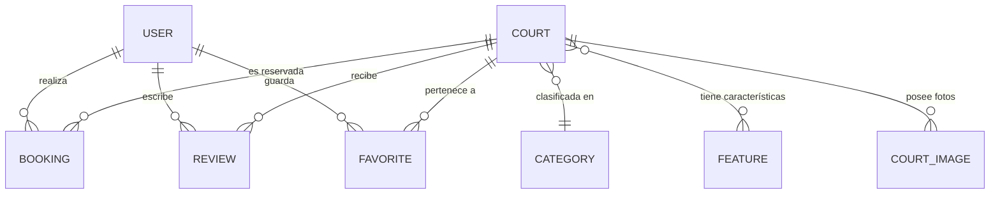

# 🏟️ Sport Court Booking — Backend API

> **API RESTful Full Stack para la reserva, gestión y valoración de canchas deportivas.**  
> Desarrollado con **Java 21 / 25, Spring Boot 3.4.x, Spring Security 6 con JWT y Spring Data JPA**.

---

## 📑 Tabla de Contenidos

- [Descripción General](#-descripción-general)
- [Tecnologías y Versiones](#-tecnologías-y-versiones)
- [Instalación y Puesta en Marcha](#-instalación-y-puesta-en-marcha)
- [Base de Datos y Configuración](#-base-de-datos-y-configuración)
- [Variables de Entorno](#-variables-de-entorno)
- [Endpoints Principales (API REST)](#-endpoints-principales-api-rest)
- [Modelo de Entidades (Diagrama ER)](#-modelo-de-entidades-diagrama-er)
- [Testing y Cobertura (73 Tests)](#-testing-y-cobertura-73-tests)
- [Correcciones Aplicadas (Sprint III Feedback)](#-correcciones-aplicadas-sprint-iii-feedback)
- [Autores](#-autores)

---

## 📌 Descripción General

El backend de **Sport Court Booking** provee la lógica de negocio, validaciones transaccionales y seguridad para el ecosistema de reserva de canchas deportivas. Sus funciones centrales abarcan:
- **Gestión de Turnos y Reservas (HU30):** Prevención de solapamiento mediante queries JPA indexadas y generación de código alfanumérico único (`SCB-XXXXXX`).
- **Notificaciones Transaccionales (HU31):** Envío automático de confirmaciones en formato HTML con remitente configurable vía `JavaMailSender`.
- **Autenticación Robusta (HU14/HU15):** Tokens JWT (HMAC-SHA256) con claims de usuario (`firstName`, `lastName`, `role`) y lista de revocación en memoria (`TokenBlacklist`).
- **Control de Acceso Basado en Roles (RBAC):** Separación de permisos entre deportistas (`USER`) y administradores (`ADMIN`).
- **Sistema de Puntuaciones (HU28):** Reseñas con soporte dual para `score` y `rating` con recálculo dinámico en tiempo real.
- **Galería de Canchas (HU6):** Soporte de múltiples imágenes por cancha para galerías de hasta 5 fotografías.

---

## ⚙️ Tecnologías y Versiones

- **Java JDK:** 21 LTS / OpenJDK 25
- **Spring Boot:** 3.4.1
- **Spring Security:** 6.x con filtro JWT `JwtAuthenticationFilter`
- **Librería JWT:** `io.jsonwebtoken:jjwt` 0.12.6
- **Persistencia:** Spring Data JPA + Hibernate ORM 6.6.x
- **Bases de Datos:**
  - H2 In-Memory (`jdbc:h2:mem:sportbooking`) para desarrollo rápido y suites de prueba.
  - MySQL 8.x / PostgreSQL compatible para entornos productivos.
- **Documentación OpenAPI:** `springdoc-openapi-starter-webmvc-ui` 2.7.0 (Swagger UI interactivo)
- **Email:** `spring-boot-starter-mail` (JavaMailSender)
- **Testing:** JUnit 5, Mockito, AssertJ, Spring Boot Test, MockMvc (73 tests ejecutados al 100% éxito)
- **Build Tool:** Apache Maven 3.9+

---

## 🚀 Instalación y Puesta en Marcha

### Requisitos Previos
- Java JDK 21 o superior instalado y configurado en el `PATH` (`java -version`).
- Maven 3.8+ (o utilizar el wrapper `./mvnw` incluido).

### Pasos para Ejecutar
1. **Navegar a la carpeta del backend:**
   ```bash
   cd sport.court.booking.backend
   ```
2. **Ejecutar la aplicación con Maven:**
   ```bash
   mvn spring-boot:run
   ```
   *(O en Linux/Mac: `./mvnw spring-boot:run`)*
3. **Verificar estado del servicio:**
   - URL Base: `http://localhost:8080`
   - Swagger Docs: `http://localhost:8080/swagger-ui/index.html`
   - OpenAPI JSON: `http://localhost:8080/v3/api-docs`
   - Consola H2: `http://localhost:8080/h2-console` (JDBC URL: `jdbc:h2:mem:sportbooking`, User: `sa`, Contraseña en blanco)

---

## 🗄️ Base de Datos y Configuración

Por defecto, el backend arranca con una base de datos en memoria **H2** lista para usar y carga datos iniciales con `DataInitializer` (categorías de fútbol, pádel, tenis, squash y básquetbol; características de iluminación, vestuarios y estacionamiento; canchas con 5 fotos de galería; y el usuario administrador `admin@sportcourt.com` / `Admin1234!`).

Si deseas conectar a MySQL local:
```sql
CREATE DATABASE sport_court_booking CHARACTER SET utf8mb4 COLLATE utf8mb4_unicode_ci;
```
Y configura en `application.properties`:
```properties
spring.datasource.url=jdbc:mysql://localhost:3306/sport_court_booking
spring.datasource.username=root
spring.datasource.password=tu_password
spring.jpa.hibernate.ddl-auto=update
```

---

## 🔐 Variables de Entorno

| Variable | Descripción | Valor por Defecto |
|:---|:---|:---|
| `SERVER_PORT` | Puerto de escucha HTTP | `8080` |
| `SPRING_DATASOURCE_URL` | Cadena de conexión JDBC | `jdbc:h2:mem:sportbooking` |
| `SPRING_DATASOURCE_USERNAME` | Usuario de base de datos | `sa` |
| `SPRING_DATASOURCE_PASSWORD` | Contraseña de base de datos | `""` |
| `APP_JWT_SECRET` | Clave secreta para firma criptográfica | `clave-secreta-sport-court-booking-super-segura-256-bits-2026-xyz` |
| `APP_JWT_EXPIRATION_MS` | Duración del token en milisegundos | `86400000` (24 horas) |
| `APP_ADMIN_EMAIL` | Correo del administrador inicial | `admin@sportcourt.com` |
| `APP_ADMIN_PASSWORD` | Contraseña del administrador inicial | `Admin1234!` |
| `SPRING_MAIL_HOST` | Host SMTP | `smtp.gmail.com` |
| `SPRING_MAIL_PORT` | Puerto SMTP | `587` |
| `SPRING_MAIL_USERNAME` | Correo emisor de notificaciones | `notificaciones@sportcourt.com` |
| `SPRING_MAIL_PASSWORD` | Contraseña de aplicación SMTP | `xxxx xxxx xxxx xxxx` |

---

## 📬 Endpoints Principales (API REST)

| Método | Endpoint | Descripción | Rol / Permiso |
|:---|:---|:---|:---:|
| `POST` | `/api/auth/register` | Registro de usuarios nuevos | ❌ Público |
| `POST` | `/api/auth/login` | Login, emisión de JWT enriquecido con perfil | ❌ Público |
| `POST` | `/api/auth/logout` | Revocación de JWT y agregado a lista negra | ✅ Autenticado |
| `GET` | `/api/courts` | Listado paginado de canchas con filtros | ❌ Público |
| `GET` | `/api/courts/{id}` | Detalle completo de una cancha | ❌ Público |
| `GET` | `/api/courts/{id}/availability` | Fechas ocupadas (para calendario doble) | ❌ Público |
| `GET` | `/api/courts/search` | Búsqueda por coincidencia de texto | ❌ Público |
| `GET` | `/api/courts/suggestions` | Sugerencias interactivas de nombres | ❌ Público |
| `POST` | `/api/courts` | Crear cancha con fotos e infraestructura | 🔒 `ADMIN` |
| `PUT` | `/api/courts/{id}` | Editar cancha | 🔒 `ADMIN` |
| `DELETE` | `/api/courts/{id}` | Eliminar cancha | 🔒 `ADMIN` |
| `POST` | `/api/bookings` | Crear reserva transaccional con email | ✅ `USER` / `ADMIN` |
| `GET` | `/api/bookings/my` | Historial de reservas del usuario | ✅ `USER` / `ADMIN` |
| `GET` | `/api/bookings/available` | Canchas libres en rango de fechas | ❌ Público |
| `GET` | `/api/courts/{id}/reviews` | Listar valoraciones y opiniones | ❌ Público |
| `POST` | `/api/courts/{id}/reviews` | Publicar reseña y recálculo de estrellas | ✅ `USER` / `ADMIN` |
| `GET` | `/api/favorites` | Listar canchas favoritas del usuario | ✅ `USER` / `ADMIN` |
| `POST` | `/api/favorites/{courtId}/toggle` | Alternar favorito | ✅ `USER` / `ADMIN` |
| `GET` | `/api/admin/users` | Listado de usuarios | 🔒 `ADMIN` |
| `PATCH` | `/api/admin/users/{id}/role` | Cambiar rol de usuario (`ADMIN`/`USER`) | 🔒 `ADMIN` |

---

## 🗂️ Modelo de Entidades (Diagrama ER)



---

## 🧪 Testing y Cobertura (73 Tests)

Para ejecutar la suite completa de pruebas:
```bash
mvn test
```

**Resultado oficial:**
```
[INFO] Results:
[INFO] Tests run: 73, Failures: 0, Errors: 0, Skipped: 0
[INFO] BUILD SUCCESS
```

---

## 🛠️ Correcciones Aplicadas (Sprint III Feedback)

1. **#28 Puntuar producto:** Incorporación de `@JsonAlias({"rating", "score", "stars"})` en `ReviewRequest` para evitar error 400 Bad Request.
2. **#23 Disponibilidad:** Endpoint `/availability` estructurado para emitir `List<String>` ISO `yyyy-MM-dd` sincronizado con el calendario doble.
3. **#14 Identificar usuario:** Inclusión de claims `firstName`, `lastName` y `fullName` en los tokens emitidos por `JwtService`.
4. **#9 Panel de administración:** Seguridad a nivel de endpoint (`SecurityConfig`) restringiendo `/api/courts` (POST/PUT/DELETE) y `/api/admin/**` a rol `ADMIN`.
5. **#6 Galería de imágenes:** Soporte para colección de imágenes `@ElementCollection List<String> images` en la entidad `Court` para hasta 5 fotos distintas.

---

## 👤 Autores

- **Giuseppe David Benavides Jiménez** — [@GBenavides90](https://github.com/GBenavides90)
- **Docente Evaluadora:** Prof. Verónica Valdez (Digital House)
